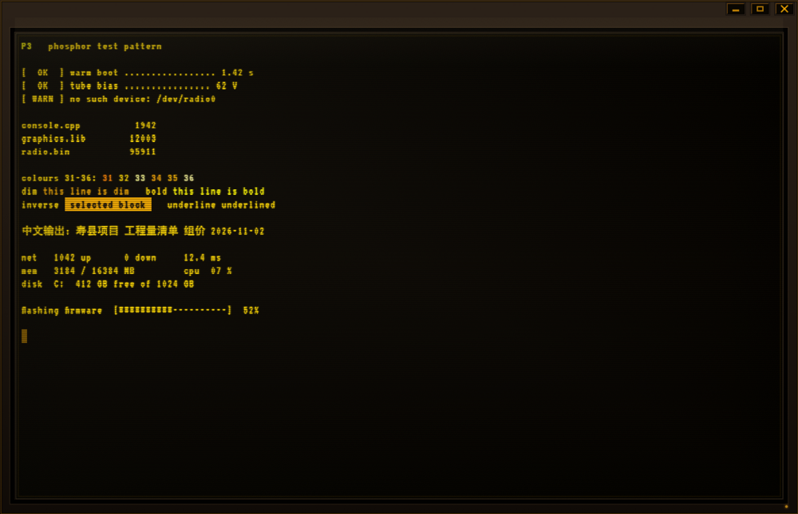

# P3 — Amber Phosphor Terminal

[简体中文](README.md) · English

The name is the military designation of the phosphor itself: **P1 green, P3 amber**, P4 white. This machine is a P3 tube.

A RADIOSOL-style monochrome amber CRT terminal, as a **native Rust desktop app**.



```bash
cargo run --release
```

Output: `target/release/p3.exe`, a single file with no runtime dependency.

Requires Rust 1.85+ (`edition = "2024"`). Works out of the box on Windows (ConPTY); Linux and macOS go through `openpty` but are not fully tested.

## Why native, not a web page

A web terminal only ever sees the shell's piped output, so line editing, prediction and completion all have to be rebuilt by hand — and it needs a local server to boot.

This one opens a **real PTY** (ConPTY on Windows) and passes keys straight through, so PowerShell's PSReadLine works exactly as it does in any other terminal:

- inline history prediction (grey text), accepted with `→` / `End`
- syntax highlighting, multi-line editing, bracket matching
- `Tab` completion menu with a signature per parameter

The emulator does the minimum a terminal has to do and lets the shell own the rest.

## Architecture

```
src/main.rs    window and eframe startup (no system title bar)
src/app.rs     cabinet + tube + title bar + grid rendering (merges the vt100 grid into colour runs each frame)
src/pty.rs     portable-pty session: ConPTY / openpty, reader and writer threads, resize
src/term.rs    vt100 parser wrapper + device query replies
src/input.rs   egui keys → xterm byte sequences
src/theme.rs   amber palette, ANSI folding, fonts
```

- **Window**: `with_decorations(false)`, title bar drawn in-app. The stock white frame makes a dark screen look like a sticker
- **PTY**: `portable-pty` (the wezterm one), ConPTY on Windows
- **VT parsing**: `vt100`, 8000 lines of scrollback
- **Rendering**: hand-drawn grid on `egui`/wgpu; adjacent cells of the same colour merge into one glyph run
- **Monochrome**: every ANSI colour, 24-bit truecolour included, folds onto one amber ramp by luminance
- **Fonts**: VT323 (OFL) built in for the pixel face; Chinese falls back to a system sans

## The screen

Painting amber text on a dark background is not a CRT. There has to be a **machine** around the picture first:

| Effect | How |
|---|---|
| Cabinet | 22px of warm plastic around the inside of the window, vertex gradient light at the top and dark at the bottom; a pure black recess around the glass |
| Glass | Square-cornered tube face (no rounding — a hard edge reads as an industrial part), a 1px warm highlight on the inner rim, a weaker reflection ring outside it |
| Phosphor bloom | Two low-opacity copies either side of every glyph, the outer pair looser and the inner pair tighter |
| Scanlines | A 1px dark band every 3px, snapped to device pixels, drawn as a filled rect rather than a stroke (antialiasing halves a stroke's opacity) |
| Screen haze | A very faint warm falloff above and below the middle line, so an empty screen is not dead black |
| Field drift | A translucent bright band creeping down the screen, one pass every 13 seconds |
| Vignette | Vertex gradients on all four sides, so the corners stack up darker on their own |
| Glass reflection | A very faint warm-white gradient in the top-left corner |
| Brightness jitter | Two sine waves at different frequencies for ±2% phosphor wobble, plus a 2px horizontal slip every 9 seconds |
| Power lamp | A small amber lamp in the bottom-right corner, breathing slowly |
| Power-on | The picture opens from a single horizontal line, leaving a bright trace at the edge |

### The monospace grid

Cell width is not taken from the Latin advance. It is derived **from half a Han character**: `cw = han_width / 2`.

The two faces in the font chain do not agree — VT323 advances 0.40 em (6.4px at a 16px size) while the Chinese fallback advances 1.00 em (16px). Use 6.4px as the cell and one Han character eats 2.5 cells, drifting a quarter cell to the right with every character, and the whole Chinese line stops looking monospaced.

So:

- `cw = han_width / 2` (8.0px at 16px), which puts a Han character on exactly two cells
- Latin runs use `TextFormat::extra_letter_spacing` to stretch the advance out to a full cell (1.6px here), which is what puts a gap between letters instead of letting them touch
- A row is split into runs on two boundaries at once, colour and single/dual width; dual-width runs get no extra spacing since they already fill two cells
- Line pitch is the font's own row height × 1.22, otherwise the descenders of a pixel face collide

### Pitfall 2: a blank cell is not an empty string

`vt100` stores a blank cell as **zero bytes**, so `cell.contents()` returns `""`. Push that straight into a run while walking the grid and the cell occupies no width at all — but the run's origin was computed from the column, so everything after the gap slides one cell left:

```
组价 2026-11-02   →   组价2026-11-02
```

It only shows up on a `wide → space → narrow` boundary, because any other case starts a new run and re-anchors to the column. Empty strings now push a single space into the run.

### Pitfall 3: Ctrl+C never reaches you

`egui-winit` rewrites `Ctrl+C` / `Ctrl+X` / `Ctrl+V` into `Event::Copy` / `Cut` / `Paste` **before** handing events to the app — a plain `Event::Key` for them never exists. A terminal that only matches on `Event::Key` does nothing when you press `Ctrl+C`, and looks broken.

So `input.rs` translates those three events back into bytes: `Copy` → `0x03` (SIGINT), `Cut` → `0x18`, `Paste` → written straight to the PTY.

Conversely, because that copy path requires Ctrl **without** Shift, `Ctrl+Shift+C` still arrives as an ordinary key and can be intercepted before the C0 table turns it into yet another SIGINT.

### Pitfall 4: PSReadLine is waiting for an answer

On startup PSReadLine sends `ESC[6n` (query cursor position) and **blocks until it gets a reply**. No reply means a blank screen that looks like a hang. `term.rs::respond` answers CPR / DA / DSR.

## Keys

| Key | Action |
|---|---|
| `Tab` | shell completion / accept prediction |
| `→` `End` | accept inline prediction |
| `Ctrl+R` | reverse history search |
| `Ctrl+C` | interrupt (sends SIGINT, does not copy) |
| Drag with the mouse | select text, continuously across lines |
| `Ctrl+Shift+C` | copy the selection |
| `Ctrl+V` | paste (multi-line goes through as-is; the shell decides) |
| `PgUp` / `PgDn` | scroll the back buffer |
| `Ctrl+=` / `Ctrl+-` / `Ctrl+0` | font size / reset |
| `F5` | restart the session |
| `Ctrl+Shift+G` | toggle scanlines |

## The window

The system title bar is gone, so the app takes over these:

| Action | Result |
|---|---|
| Drag empty title bar space | move the window |
| Double-click the title bar | maximise / restore |
| Drag within 7px of any edge or corner | resize (cursor changes) |
| The three stamped keys top right | minimise / maximise / close (bevelled, face lights when pressed) |

The cost of dropping system decorations is that Windows Aero Snap (drag to the top edge to maximise) no longer fires; double-clicking the title bar covers it.

Select text with the mouse, then `Ctrl+Shift+C` to copy. A single click anywhere clears the selection.

## Environment

| Variable | Purpose |
|---|---|
| `P3_SHELL` | override the shell executable to launch |
| `P3_DUMP` | dump the current screen to this path every 0.5s (debugging) |
| `P3_SHOT` | grab one frame to a 32-bit BMP and exit (verify rendering without a display) |

The `P3_DUMP` output looks like this and is enough to confirm the PTY/VT chain without looking at a screen:

```
# grid 110x40  cell 8.25x17.56  rect 932x729  inner 908x705
# cursor (0, 59)  hidden false  scroll 0  exited false  rx 602  pid Some(11040)
PS C:\...> 
```

## Known limits

- Chinese width relies on the font being naturally uniform; heavy mixed typesetting can be off by a cell
- The selection only covers what is on screen: scrolling, zooming and resizing all clear it, because cell coordinates stop meaning anything
- No hyperlink clicking and no mouse reporting (`vim` and `htop` cannot be clicked or scrolled)
- No barrel distortion: that needs a custom wgpu render pass, which the egui layer cannot do

## Licence

Code is MIT, see `LICENSE`.

The bundled VT323 font is by Peter Hull, SIL Open Font License 1.1, full text in `assets/OFL.txt`.
Chinese falls back to a system font and is not redistributed with the binary.
