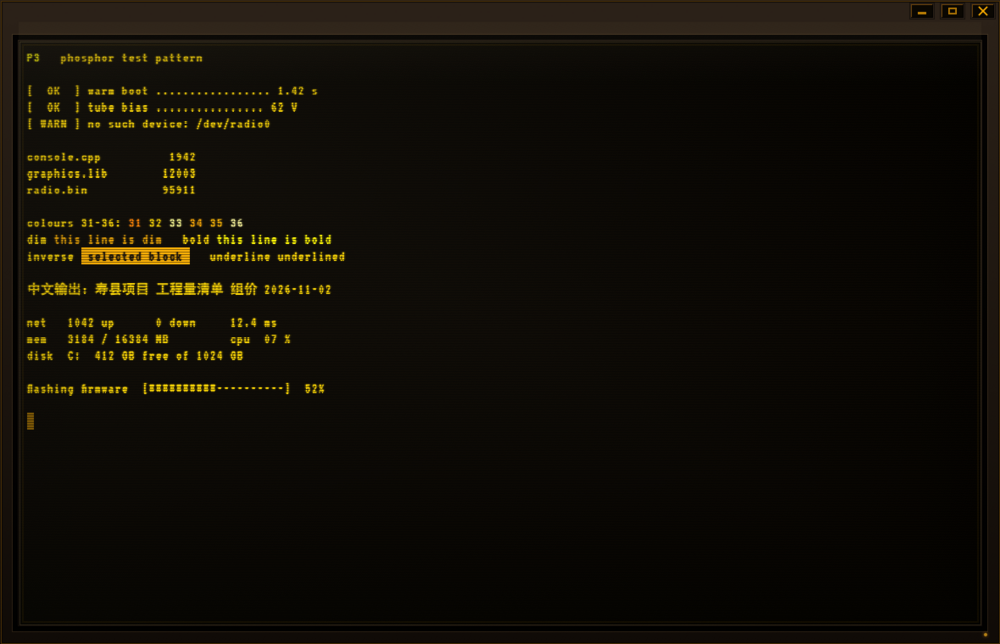

# P3 — 琥珀磷光终端

[English](README.md) · 简体中文

名字取自显像管磷光粉的军标代号：**P1 绿、P3 琥珀**、P4 白。这台机器就是一块 P3 管。

RADIOSOL 那种琥珀单色 CRT 终端，**原生 Rust 桌面应用**。



```bash
cargo run --release
```

产物：`target/release/p3.exe`（单文件，无需运行时）。

需要 Rust 1.85+（`edition = "2024"`）。Windows 开箱可用（ConPTY）；Linux / macOS 走 `openpty`，未做完整验证。

## 为什么是原生而不是网页

同名的网页版只能拿到 shell 的管道输出，行编辑、预测、补全全得自己手搓，还得开个本地服务。
原生版直接开一个**真 PTY**（Windows 用 ConPTY），按键直通 shell —— PowerShell 的 PSReadLine 原样工作：

- 内联历史预测（灰字），`→` / `End` 接受
- 语法高亮、多行编辑、括号匹配
- `Tab` 菜单补全，含每个参数的签名

终端模拟器该做的事这里只做最小集，剩下的交给 shell 自己。

## 架构

```
src/main.rs    窗口与 eframe 启动（无系统标题栏）
src/app.rs     机壳 + 显像管 + 标题栏 + 网格渲染（每帧把 vt100 网格合并成色块 run）
src/pty.rs     portable-pty 会话：ConPTY / openpty，读写线程，resize
src/term.rs    vt100 解析器包装 + 设备查询应答
src/input.rs   egui 按键 → xterm 字节序列
src/theme.rs   琥珀色板、ANSI 折叠、字体
```

- **窗口**：`with_decorations(false)`，标题栏自己画。系统那圈白底会把整块暗屏衬得像贴纸
- **PTY**：`portable-pty`（wezterm 那套），Windows 走 ConPTY
- **VT 解析**：`vt100`，8000 行回滚
- **渲染**：`egui`/wgpu 自绘网格，相邻同色 cell 合并成一个 glyph run
- **单色**：所有 ANSI 色（含 24 位真彩）按亮度折回一条琥珀色阶
- **字体**：内置 VT323（OFL），点阵字形；中文回落到系统黑体

## 屏幕

不是把字画在深色背景上就算 CRT。先得有个**机器**，屏幕上才有画面：

| 效果 | 做法 |
|---|---|
| 机壳 | 窗口内 22px 一圈暖色塑料，上亮下暗的顶点渐变；玻璃外一圈纯黑凹槽 |
| 玻璃 | 直角显像管面（不做圆角，硬边更像机柜上的工业件），内缘一道 1px 暖光，外缘再套一圈更弱的反光 |
| 磷光辉光 | 每个字形左右各画两层低透明度副本（外层更散、内层更紧） |
| 扫描线 | 每 3px 一条 1px 暗带，对齐设备像素，用矩形填而不是描边（描边会被抗锯齿摊薄成一半） |
| 屏面雾光 | 屏幕中线往上下各一条极淡暖色渐隐，免得空屏是死黑一片 |
| 场同步漂移 | 一条半透明亮带缓慢下移，13 秒一轮 |
| 暗角 | 四边顶点渐变，角上自然叠得更深 |
| 玻璃反光 | 左上角一块极淡的暖白渐变 |
| 亮度抖动 | 两个不同频率的正弦叠出 ±2% 的磷光波动，外加每 9 秒一次 2px 水平错位 |
| 电源灯 | 右下角一颗琥珀色小灯，缓慢呼吸 |
| 开机 | 画面从一条水平线展开，边缘留一道余亮 |

### 等宽网格

单元格宽度不是按拉丁字母的字宽取的，而是**按半个汉字反推**：`cw = 汉字宽 / 2`。

两个字体链里的字面本来就不一致 —— VT323 的 advance 是 0.40 em（16px 字号下 6.4px），
中文回落的黑体是 1.00 em（16px）。如果拿 6.4px 当格子，一个汉字会吃掉 2.5 格，
每写一个汉字就向右漂 0.25 格，整个中文行看着就不是等宽的。

所以：

- `cw = 汉字宽 / 2`（16px 字号下 8.0px），汉字正好两格
- 拉丁字符用 `TextFormat::extra_letter_spacing` 把 advance 撑到满格（这里补 1.6px），
  字与字之间才有缝，不再贴在一起
- 一行按「颜色」和「单/双宽」两种边界切段，双宽段不加字距，因为本身已经占满两格
- 行距 = 字体自带行高 × 1.22，不然像素字体的下伸部会挨到一起

### 第二个坑：空白格不是没有字符

`vt100` 把空白格存成**零字节**，`cell.contents()` 返回 `""`。如果照着网格拼接 run 时把空串直接
`push_str` 进去，这个格子就没占任何字宽，而 run 的起点是按列算好的 —— 结果是空格后面整段左移一格：

```
组价 2026-11-02   →   组价2026-11-02
```

只在「宽字符 → 空格 → 窄字符」的边界发作，因为其它情况切段时会把起点重新对齐到列。
现在空串统一补一个空格进 run。

### 第三个坑：Ctrl+C 到不了你手里

`egui-winit` 在把按键交给应用之前就把 `Ctrl+C` / `Ctrl+X` / `Ctrl+V` 换成了
`Event::Copy` / `Cut` / `Paste` —— 一个普通的 `Event::Key` 根本不会出现。
只写 `Event::Key` 分支的终端，`Ctrl+C` 按下去毫无反应，像坏了。

所以 `input.rs` 里这三个事件要自己翻译回字节：`Copy` → `0x03`（SIGINT）、
`Cut` → `0x18`、`Paste` → 直接写进 PTY。

反过来，因为那条复制路径要求 Ctrl **不带** Shift，`Ctrl+Shift+C` 仍然是普通按键，
能在 `key_bytes` 的 C0 表把它变成又一个 SIGINT 之前截下来。

### 第四个坑：PSReadLine 在等你回话

PSReadLine 启动时会发 `ESC[6n`（查询光标位置）并**阻塞等待回复**。不回就是一片空白、看起来像卡死。`term.rs::respond` 负责应答 CPR / DA / DSR。

## 快捷键

| 键 | 作用 |
|---|---|
| `Tab` | shell 补全 / 接受预测 |
| `→` `End` | 接受内联预测 |
| `Ctrl+R` | 历史反查 |
| `Ctrl+C` | 中断（发 SIGINT，不是复制） |
| 鼠标拖选 | 选中文本，跨行连续选择 |
| `Ctrl+Shift+C` | 复制选区到剪贴板 |
| `Ctrl+V` | 粘贴（多行也照发，shell 自己处理） |
| `PgUp` / `PgDn` | 翻看回滚缓冲 |
| `Ctrl+=` / `Ctrl+-` / `Ctrl+0` | 字号 / 复位 |
| `F5` | 重开会话 |
| `Ctrl+Shift+G` | 扫描线开关 |

## 窗口

系统标题栏被去掉了，这几件事由应用自己接管：

| 操作 | 效果 |
|---|---|
| 拖标题栏空白处 | 移动窗口 |
| 双击标题栏 | 最大化 / 还原 |
| 窗口四边、四角 7 px 内拖动 | 缩放（光标会变） |
| 右上角三个冲压字键 | 最小化 / 最大化 / 关闭（斜边倒角，按下键面点亮） |

去掉系统装饰的代价是 Windows 的 Aero Snap（拖到屏幕顶部最大化）不再触发，用双击标题栏代替。

选中文字后按 `Ctrl+Shift+C` 复制。单击任意位置取消选区。

## 环境变量

| 变量 | 作用 |
|---|---|
| `P3_SHELL` | 覆盖要启动的 shell 可执行文件 |
| `P3_DUMP` | 每 0.5 秒把当前屏幕写到该路径（排障用） |
| `P3_SHOT` | 抓一帧存成 32 位 BMP 后退出（无显示器时验证渲染） |

`P3_DUMP` 的产物长这样，用来确认 PTY/VT 链路而不必看屏幕：

```
# grid 110x40  cell 8.25x17.56  rect 932x729  inner 908x705
# cursor (0, 59)  hidden false  scroll 0  exited false  rx 602  pid Some(11040)
PS C:\...> 
```

## 已知限制

- 中文字符宽度靠字体天然等宽近似，复杂混排可能有一格偏移
- 选区只覆盖当前屏幕：滚动、缩放、resize 都会清掉，因为格坐标会失效
- 没有超链接点击，也没有鼠标报告（`vim` / `htop` 里点不动）
- 无桶形畸变：要自定义 wgpu 渲染通道，egui 图层做不到

## 许可

代码 MIT，见 `LICENSE`。

内置字体 VT323 由 Peter Hull 制作，SIL Open Font License 1.1，全文见 `assets/OFL.txt`。
中文回落到系统自带字体，不随程序分发。
